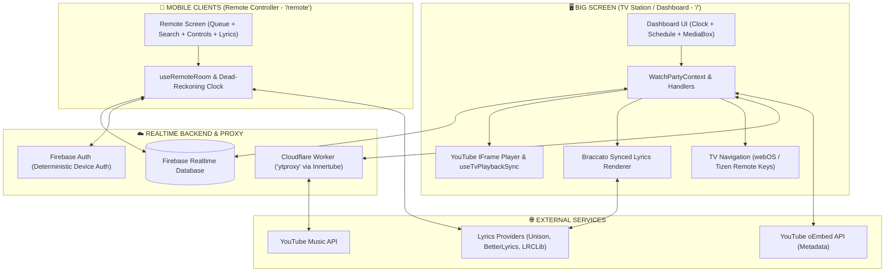

# MediaBox Documentation Hub 🛸📺

Welcome to the comprehensive documentation for **MediaBox**! 

MediaBox is a modern, retro-futuristic, dual-screen interactive media station designed for communal spaces—specifically classrooms, shared lounges, and living rooms. It pairs a **Big Screen TV Dashboard** (acting as the audiovisual display and party host) with a **Mobile Web Remote** (letting anyone in the room queue music, search songs, tweak volume, and sing along to synchronized karaoke lyrics right from their phone).

Whether you are a software engineer wanting to understand the architecture, a deployment engineer rolling it out to Smart TVs, or an LLM reasoning over the codebase, this documentation suite has been engineered to be **exhaustive, structured, and easy to digest**.

---

## 🗺️ Documentation Directory

| Document | Description | Target Audience |
| :--- | :--- | :--- |
| **[1. System Architecture & Data Flow](file:///D:/coding/BoredKevin/mediabox/docs/architecture-and-data-flow.md)** | The dual-persona model, CQRS command pattern, clock synchronization, and end-to-end event loops. | Architects, Engineers, LLMs |
| **[2. Firebase Schema, State & Security](file:///D:/coding/BoredKevin/mediabox/docs/firebase-schema-and-security.md)** | Full RTDB data tree, security rules breakdown, persistent device auth, and permission hierarchy. | Backend, Security, LLMs |
| **[3. Playback, Queue & Smart Autoplay](file:///D:/coding/BoredKevin/mediabox/docs/playback-queue-and-autoplay.md)** | YouTube IFrame player integration, error resilience, tri-tier queue resolution, and recommendation algorithms. | Audio/Video Devs, UI Engineers |
| **[4. Lyrics Pipeline & Karaoke Engine](file:///D:/coding/BoredKevin/mediabox/docs/lyrics-and-karaoke-engine.md)** | 7-stage lyrics resolution cascade, Braccato Core rendering, Smart TV 22Hz tick throttling, and color extraction. | Performance & Frontend Devs |
| **[5. Search Proxy & Cloudflare Worker](file:///D:/coding/BoredKevin/mediabox/docs/search-proxy-and-worker.md)** | Privacy-preserving TV search mediation, Innertube integration, and BotGuard-proof Cloudflare Worker proxy. | DevOps, Cloud & Security |
| **[6. Smart TV & Classroom Display](file:///D:/coding/BoredKevin/mediabox/docs/smart-tv-and-classroom-display.md)** | Classroom schedule carousel, period countdowns, webOS/Tizen hardware remote navigation, and i18n. | UI/UX & Embedded TV Engineers |
| **[7. Developer & LLM Operational Guide](file:///D:/coding/BoredKevin/mediabox/docs/developer-and-llm-cheatsheet.md)** | Quick-reference cheat sheet, code locations, CLI commands, critical invariants, and debugging playbooks. | Developers, AI Agents |
| **[Handoff: Word-Fill Stutter Investigation](file:///D:/coding/BoredKevin/mediabox/docs/handoff_word_fill_stutter.md)** | In-depth engineering investigation into karaoke word-fill micro-jumps under 8.9× CPU throttling. | Core Performance Engineers |

---

## ⚡ The Big Picture: How MediaBox Works



---

## 🎯 Key Design Principles

1. **Dual-Persona Architecture**:
   - The **TV Host** (`/`) is the authority. It renders the high-impact visual display, runs the actual media player, drives the audio output, and acts as the room master.
   - The **Mobile Remote** (`/remote` or `/join?room=...`) is an ultra-fast, responsive web controller. Any phone connected to the local Wi-Fi or internet can jump in by simply scanning a QR code or entering a 6-digit room PIN.
2. **Command-Query Responsibility Segregation (CQRS)**:
   - Guests do not touch playback state directly. Instead, they write timestamped intention commands to their own member record (`rooms/<room>/members/<uid>/command`). The TV Host validates, executes, updates the room state, and clears the command.
3. **Zero-Config Persistent Identity**:
   - Devices authenticate transparently using deterministic synthetic credentials (`dev_<uuid>@mediabox.tv`). No account registration or email confirmations are required for guests to start queueing tracks immediately.
4. **Resilient Playback & Smart Autoplay**:
   - When the user's queue runs dry, MediaBox does not go silent. It transitions seamlessly into an intelligent YouTube Music Automix queue, using audio purity scoring, deduplication, and artist repeat suppression.
5. **Smart TV Hardware First**:
   - Built to run smoothly on low-power ARM processors found in budget Smart TVs (such as LG webOS or Samsung Tizen). Animations are throttled to 22Hz for DOM updates, heavy blurs are replaced with lightweight gradients, and physical TV remote buttons (Escape, Back, Media keys, D-pad) are natively supported.
6. **Classroom & Communal Awareness**:
   - Integrates live schedule timetables, auto-scrolling period carousels, and automated 10-second warning countdowns before class periods or breaks begin.

---

## 🚀 Quick Start for Humans

```bash
# 1. Install dependencies
npm install

# 2. Run local development server
npm run dev

# 3. Build for production (compiles licenses + checks TS + builds Vite bundle)
npm run build

# 4. Preview the production build locally
npm run preview
```

Open `http://localhost:5173/` in your browser for the **TV Dashboard**, and `http://localhost:5173/remote` for the **Mobile Remote**.

---

## 🤖 Note for AI Assistants & LLMs

When modifying or analyzing MediaBox:
- **Never mutate the TV playback state from a remote component**. Always dispatch a command via `sendCommand(type, payload)` through `useRemoteRoom.ts`.
- **Never expose API keys or proxy credentials in Firebase RTDB**. Host proxy secrets live in host-local `localStorage` and queries are proxied via `searchRequests`/`searchResults`.
- **Preserve clock synchronization primitives**: Always use `getServerTime()` from `src/lib/serverTime.ts` to calculate timestamps across distributed clients.
- Read **[Developer & LLM Operational Guide](file:///D:/coding/BoredKevin/mediabox/docs/developer-and-llm-cheatsheet.md)** for detailed invariants and directory maps.
