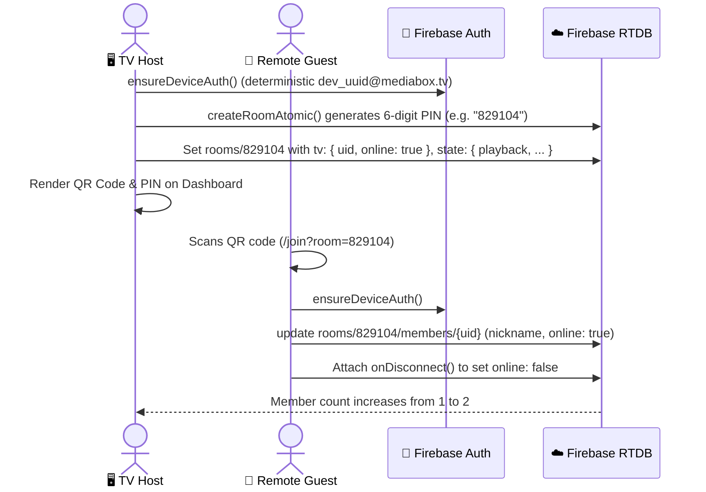

# System Architecture & Real-Time Data Flow 🔄

MediaBox is designed as a **Host-Driven Distributed Media Station**. Rather than having all clients run independent media players and hoping they stay synchronized, MediaBox designates one client as the **Authoritative Media Host** (the TV Dashboard) and all other participants as **Interactive Remote Controllers** (the Mobile Remotes).

This document breaks down the core architecture, the CQRS-inspired command pipeline, clock synchronization protocols, and the real-time event loops that power the experience.

---

## 🏛️ The Dual-Persona Mental Model

To understand MediaBox, think of it like a jukebox at an arcade or a karaoke lounge:

```
+-----------------------------------------------------------+
|                        THE ROOM                           |
|                                                           |
|    +-------------------+         +-------------------+    |
|    |   Big Screen TV   |         |   Smartphones     |    |
|    |   (Host / Engine) |         |   (Controllers)   |    |
|    +---------+---------+         +---------+---------+    |
|              |                             |              |
|              +--------------+--------------+              |
|                             |                             |
|                             v                             |
|             Firebase Realtime Database (RTDB)             |
+-----------------------------------------------------------+
```

1. **The TV Station (`/` -> `Dashboard.tsx`)**:
   - Creates and owns the room (represented by a 6-digit PIN code like `481920`).
   - Owns the physical audio and video output via an embedded YouTube IFrame player.
   - Enforces room rules, permissions, rate limits, and autoplay recommendations.
   - Listens to incoming member commands and updates the database state accordingly.

2. **The Mobile Remote (`/remote` -> `RemoteView.tsx`)**:
   - Joins an existing room via 6-digit PIN or QR code link (`/join?room=481920`).
   - Does **not** play media or audio directly (saving mobile bandwidth and battery).
   - Provides a responsive touchscreen controller: track searching, queue management, volume sliders, and full synchronized karaoke lyrics display.

---

## 📬 The CQRS Command Pattern

In a communal room with dozens of students or friends, multiple people might hit "Play", "Skip", or "Add to Queue" simultaneously. If every phone wrote directly to the room's playback state in Firebase, race conditions, state clobbering, and audio desynchronization would be rampant.

To solve this cleanly, MediaBox uses a pattern inspired by **CQRS (Command-Query Responsibility Segregation)**:

```mermaid
sequenceDiagram
    autonumber
    actor Guest as 📱 Remote Guest
    participant RTDB as ☁️ Firebase RTDB
    participant TV as 🖥️ TV Host (Dashboard)
    participant YT as 🎬 YouTube IFrame Player

    Guest->>RTDB: Write command to rooms/{room}/members/{uid}/command<br/>{ type: "pause", createdAt: 1729150000 }
    Note over RTDB,TV: TV Host is subscribed to members node via onValue()
    RTDB-->>TV: Snapshot update (command detected)
    TV->>TV: processMemberCommand() validates authorization & roomLock
    TV->>YT: playerInstance.pauseVideo()
    TV->>RTDB: update("rooms/{room}/state/playback", { status: "paused", updatedAt: now })
    TV->>RTDB: remove("rooms/{room}/members/{uid}/command")
    RTDB-->>Guest: Realtime state update arrives; UI renders "PAUSED"
```

### Why this design shines:
- **Authorization Enforcement**: The TV Host verifies whether the user is permitted to perform the action. If the room is locked (`roomState.isLocked === true`) and the user is a regular guest, the TV simply ignores the command and logs a warning.
- **De-duplication**: Each command is tagged with `${memberUid}:${createdAt || type}` in an in-memory `Set`. The TV will never accidentally execute the same command twice.
- **Self-Cleaning**: As soon as the command is processed, the TV deletes the `command` node, keeping the database footprint tiny and lightweight.

---

## ⏱️ Clock Synchronization & Dead-Reckoning

How can a phone screen display lyric lines moving at the exact millisecond the singer vocalizes them on the TV, without streaming video to the phone?

The answer is **Firebase Server Time Normalization + Client-Side Dead-Reckoning**.

### 1. Clock Skew Elimination (`getServerTime.ts`)
Different devices have slightly different internal system clocks (often varying by 200ms to 5,000ms). MediaBox uses Firebase's internal time offset node (`.info/serverTimeOffset`):

$$\text{serverTimeOffset} = \text{Firebase Server Time} - \text{Local Device Time}$$
$$\text{getServerTime()} = \text{Date.now()} + \text{serverTimeOffset}$$

Both the TV and every mobile remote compute their timestamps against this normalized reference point.

### 2. TV Host Playback Broadcast (`useTvPlaybackSync.ts`)
While playing, the TV Host samples the YouTube IFrame player and writes a lightweight heartbeat to `rooms/{room}/state/playback`:
```json
{
  "status": "playing",
  "positionMs": 42150,
  "updatedAt": 1729154200000,
  "volume": 85
}
```
- **Periodic Heartbeat**: Flushed every 1.5 seconds.
- **Drift Catching**: If the player buffers or micro-stutters and drifts by more than `300ms` from the projected timeline, an immediate synchronization packet is dispatched.
- **Buffering Awareness**: If YouTube is in state `BUFFERING` (state code `3`), the TV pauses position advancement so remotes do not race ahead.

### 3. Remote Dead-Reckoning (`RemoteLyricsView.tsx`)
Instead of polling the database 60 times a second, the mobile remote calculates the current playback position purely client-side:

$$\text{currentTime} = \frac{\text{positionMs}}{1000} + \max\left(0, \frac{\text{getServerTime()} - \text{updatedAt}}{1000}\right)$$

This provides 60 FPS silky-smooth lyric animations on mobile phones with practically **zero network traffic**.

---

## 🔄 Core End-to-End Data Flows

### Flow 1: Room Creation & Mobile Joining



### Flow 2: Searching & Adding a Song to Queue

```mermaid
sequenceDiagram
    actor Guest as 📱 Remote Guest
    participant RTDB as ☁️ Firebase RTDB
    participant TV as 🖥️ TV Host
    participant YTM as 🎵 YouTube Music / Proxy
    participant oEmbed as ℹ️ YouTube oEmbed

    Guest->>Guest: Types "Starboy The Weeknd" in Search Panel
    Guest->>RTDB: set rooms/{room}/searchRequests/{reqId}
    RTDB-->>TV: onValue("searchRequests") fires on TV
    TV->>TV: Checks searchRateLimits/{guestUid} (e.g. max 10/5min)
    TV->>YTM: searchYTMusic("Starboy The Weeknd") via Cloudflare Worker
    YTM-->>TV: Returns ranked search candidates
    TV->>RTDB: set rooms/{room}/searchResults/{reqId} (results array)
    TV->>RTDB: remove rooms/{room}/searchRequests/{reqId}
    RTDB-->>Guest: Search results arrive; Guest taps "+ Add to Queue"
    Guest->>RTDB: Write command: { type: "addToQueue", payload: { url: "..." } }
    RTDB-->>TV: TV receives command
    TV->>oEmbed: fetchVideoTitle(url) (zero-config metadata fetch)
    TV->>RTDB: push rooms/{room}/queue/{itemId} { url, title, addedBy, addedAt }
    TV->>RTDB: remove command
```

---

## 🗂️ Component & Architecture Map

Here is how the project directories correspond to architectural layers:

```
src/
├── components/
│   ├── mediabox/          # TV Player container, QR modal, overlay controls
│   ├── remote/            # Mobile remote views, navigation panels, settings
│   │   ├── panels/        # QueuePanel, SearchPanel, MembersPanel
│   │   └── hooks/         # useRemoteRoom (remote data subscription engine)
│   ├── lyrics/            # Braccato Web Component lyrics renderers & fullviews
│   └── tv-settings/       # Host settings modal tabs (behavior, limits, API keys)
├── context/
│   ├── WatchPartyContext.tsx # Central brain & state machine for the TV Host
│   └── hooks/             # Subscriptions, autoplay history, volume debouncing
├── handlers/              # Pure domain logic functions for commands & transitions
│   ├── commandHandler.ts  # Validates and executes guest commands
│   ├── playbackHandler.ts # Next track, previous track, history stack transitions
│   ├── queueHandler.ts    # Adding, removing, clearing, reordering items
│   ├── autoplayHandler.ts # Smart autoplay, audio purity, deduplication rules
│   └── searchProxyHandler.ts # Mediates remote search requests on the TV
└── lib/                   # Infrastructure, API clients, and utilities
    ├── deviceAuth.ts      # Deterministic device credentials & Firebase Auth
    ├── roomUtils.ts       # Room interfaces, validators, atomic room generators
    ├── lyricsService.ts   # 7-stage fallback cascade for synchronized lyrics
    ├── ytmusicSearch.ts   # Innertube YouTube Music search module
    └── serverTime.ts      # High-precision Firebase clock offset manager
```

> [!TIP]
> **Key Architectural Takeaway**: The TV Dashboard is a state machine running in the browser. The Firebase Realtime Database is its distributed event bus. Mobile devices are thin query-and-command clients. This architecture guarantees that no matter how many phones connect to the room, playback will never glitch or skip.
