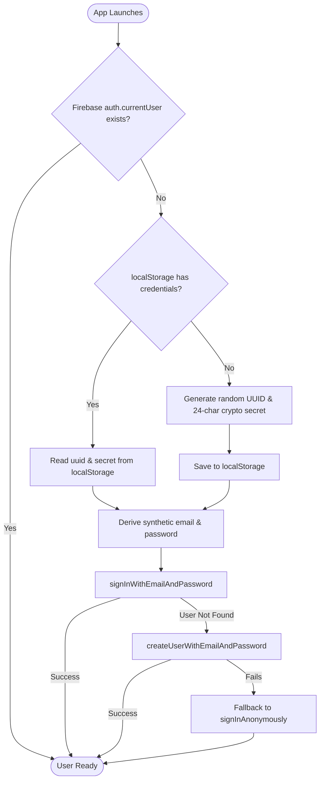

# Firebase Schema, State & Security 🔐

This document specifies the exact **Firebase Realtime Database (RTDB)** data structures, the role-based security rules enforcing integrity, and the ingenious **Deterministic Device Authentication** system powering MediaBox.

---

## 🌳 Realtime Database Schema Tree

All data in MediaBox lives under two top-level branches: `/admins` and `/rooms`.

```
/
├── admins/
│   └── <adminUid>: true
│
└── rooms/
    └── <roomId> (e.g. "481920")/
        ├── tv/
        │   ├── uid: string               # Firebase UID of the TV Host instance
        │   ├── createdAt: number         # Unix millisecond timestamp
        │   ├── online: boolean           # Presence flag (.info/connected)
        │   └── lastSeen: number          # Unix timestamp of last heartbeat
        │
        ├── state/
        │   ├── currentlyPlaying: string  # Full YouTube URL or ID currently playing
        │   ├── currentlyPlayingTitle: string # oEmbed/parsed title of current track
        │   ├── hostUid: string           # UID of the room creator or appointed host
        │   ├── isFullscreen: boolean     # Whether the TV is in kiosk/fullscreen mode
        │   ├── isLocked: boolean         # When true, only Host/Admin can control playback
        │   ├── isAutoplay: boolean       # Autoplay mode enabled/disabled
        │   ├── isCountdownEnabled: boolean # 10s schedule period countdown overlay toggle
        │   ├── lyricsOffsetMs: number    # Audio-to-lyric manual calibration (-10000 to +10000ms)
        │   ├── lyricsWordSync: boolean   # Word-by-word coalesce mode toggle
        │   ├── playback/
        │   │   ├── status: "playing" | "paused"
        │   │   ├── positionMs: number    # Current playback position in milliseconds
        │   │   ├── volume: number        # Master TV volume (0 to 100)
        │   │   └── updatedAt: number     # ServerTime timestamp when position was recorded
        │   └── searchSettings/
        │       ├── maxResults: number    # Max candidates returned per search (1 to 50)
        │       ├── rateLimitCount: number# Searches allowed per window (e.g. 10)
        │       ├── rateLimitWindowMs: number # Rolling window duration (min 10000ms, default 300000ms)
        │       ├── preferMusicVideos: boolean # Prioritize YouTube Music audio / Topic channels
        │       ├── isProxyConfigured: boolean # Whether TV has local proxy credentials
        │       └── proxyUrl: string      # Public worker URL (secrets are never stored here!)
        │
        ├── queue/
        │   └── <itemId> (e.g. "q_1729154000_abc")/
        │       ├── id: string
        │       ├── url: string           # YouTube video URL
        │       ├── title: string         # Track title (resolved via oEmbed)
        │       ├── addedBy: string       # UID of the user who queued it
        │       └── addedAt: number       # Unix timestamp
        │
        ├── radioQueue/ (optional runtime automix cache)
        │   └── [ { id, title, channelTitle, thumbnail, url } ]
        │
        ├── searchRequests/
        │   └── <reqId> (e.g. "<uid>_1729154000")/
        │       ├── requestedBy: string   # Member UID
        │       ├── query: string         # Search keyword string
        │       └── createdAt: number
        │
        ├── searchResults/
        │   └── <reqId>/
        │       ├── results: SearchResultItem[]
        │       ├── error: string | null
        │       └── respondedAt: number
        │
        ├── searchRateLimits/
        │   └── <memberUid>/
        │       ├── count: number         # Number of searches executed in current window
        │       └── windowStart: number   # Start timestamp of rolling window
        │
        └── members/
            └── <memberUid>/
                ├── uid: string           # Matches $memberUid
                ├── joinedAt: number
                ├── nickname: string      # Display name (max 25 chars)
                ├── online: boolean       # Realtime connection status
                ├── lastSeen: number
                └── command: MemberCommand | null # CQRS command queue slot
                    ├── type: string      # "play", "pause", "addToQueue", "seek", etc.
                    ├── createdAt: number
                    └── payload: object   # Command-specific parameters
```

---

## 🛡️ Security Rules Analysis (`database.rules.json`)

MediaBox enforces strict security invariants in `database.rules.json`:

### 1. Room Creation & Ownership
```json
"rooms": {
  "$roomId": {
    ".read": "auth != null",
    ".write": "!data.exists() ? auth != null : data.child('tv/uid').val() === auth.uid"
  }
}
```
- **Read**: Any authenticated user can read room data.
- **Write**: A room can only be created by an authenticated user. Once created, **only the TV Host** (`tv/uid === auth.uid`) has top-level write permissions. Remotes cannot directly overwrite room state!

### 2. Member Node Protection
```json
"members": {
  "$memberUid": {
    ".read": "auth != null",
    ".write": "$memberUid === auth.uid || root.child('rooms/' + $roomId + '/tv/uid').val() === auth.uid",
    "uid": { ".validate": "newData.val() === auth.uid" },
    "nickname": { ".validate": "newData.val() === null || (newData.isString() && newData.val().length <= 25)" }
  }
}
```
- A user can **only write to their own member record** (`$memberUid === auth.uid`), or the TV Host can write to it (e.g. when kicking a user).
- A user cannot forge another user's UID in the member object.

### 3. Command Whitelisting & Privileged Command Validation
Under `members/$memberUid/command`, the security rules strictly enforce:
1. `type` must match one of the whitelisted commands:
   - `play`, `pause`, `addToQueue`, `removeFromQueue`, `adjustVolume`, `forceSkip`, `forcePrevious`, `previousTrack`, `reorderQueue`, `forceRemoveFromQueue`, `kickMember`, `toggleFullscreen`, `clearQueue`, `toggleRoomLock`, `toggleAutoplay`, `startRadio`, `startRadioFromCurrent`, `toggleCountdown`, `togglePreferMusicVideos`, `searchYouTube`, `manageApiKeys`, `setYtProxy`, `setProxy`, `setLyricsOffset`, `setLyricsWordSync`.
2. **Privilege Isolation**: Sensitive commands (like `manageApiKeys`, `setYtProxy`, `setLyricsWordSync`, `togglePreferMusicVideos`) are strictly rejected by the database engine unless:
   $$\text{callerUid} == \text{hostUid} \lor \text{callerUid} \in \text{admins} \lor \text{callerUid} == \text{tvOwnerUid}$$

### 4. Queue Item Deletion Safeguard
```json
"queue": {
  "$itemId": {
    ".write": "data.exists() && !newData.exists() && data.child('addedBy').val() === auth.uid"
  }
}
```
- A regular guest can directly delete an item from the queue **only if they were the person who added it** (`data.child('addedBy').val() === auth.uid`).
- If an admin or host wants to remove someone else's song, they dispatch a `forceRemoveFromQueue` command to the TV Host.

---

## 🔑 Deterministic Device Authentication (`deviceAuth.ts`)

### The Problem
Traditional Firebase Anonymous Authentication has severe flaws in communal environments:
1. If browser cookies or `IndexedDB` get cleared, or the guest opens an incognito window, Firebase generates a brand new UID.
2. If Firebase projects disallow anonymous auth for security reasons, the entire app fails to launch.
3. Mobile users frequently close and reopen browser tabs, losing their room membership and nickname.

### The Solution: Deterministic Synthetic Device Accounts
MediaBox implements a zero-friction, persistent identity system in `src/lib/deviceAuth.ts`:



1. **Deterministic Email**: Derived from the device UUID:
   ```typescript
   export const credentialsToEmail = (uuid: string): string => {
     const cleanUuid = uuid.replace(/[^a-zA-Z0-9]/g, '').toLowerCase();
     return `dev_${cleanUuid}@mediabox.tv`;
   };
   ```
2. **Deterministic Password**: Derived from the cryptographically random secret:
   ```typescript
   export const credentialsToPassword = (secret: string): string => {
     return `Mbx!${secret}#9`;
   };
   ```
3. **Optional Account Upgrades**:
   - Users can choose to sign in with their Google account via `signInWithGoogle()`.
   - Their nickname and preferences are seamlessly carried over.

---

## 👥 Role & Permissions Matrix

| Capability | TV Host | Room Host | Admin | Regular Guest |
| :--- | :---: | :---: | :---: | :---: |
| **Play / Pause / Seek** | ✅ | ✅ | ✅ | ✅ (Unless Room Locked) |
| **Adjust Volume** | ✅ | ✅ | ✅ | ✅ (Unless Room Locked) |
| **Add Video to Queue** | ✅ | ✅ | ✅ | ✅ (Unless Room Locked) |
| **Remove Own Queued Video** | ✅ | ✅ | ✅ | ✅ |
| **Force Remove Any Video** | ✅ | ✅ | ✅ | ❌ |
| **Reorder Queue** | ✅ | ✅ | ✅ | ❌ |
| **Clear Entire Queue** | ✅ | ✅ | ✅ | ❌ |
| **Skip Track / Previous Track** | ✅ | ✅ | ✅ | ❌ |
| **Lock / Unlock Room** | ✅ | ✅ | ✅ | ❌ |
| **Toggle Autoplay / Automix** | ✅ | ✅ | ✅ | ❌ |
| **Toggle Fullscreen Mode** | ✅ | ✅ | ✅ | ❌ |
| **Kick Member** | ✅ | ✅ | ✅ | ❌ |
| **Calibrate Lyrics Offset** | ✅ | ✅ | ✅ | ❌ |
| **Configure API & CORS Proxy**| ✅ | ✅ | ✅ | ❌ |
| **Clear Rate Limits** | ✅ | ✅ | ✅ | ❌ |

> [!NOTE]
> **Who is the "TV Host"?**: The TV Host is the device displaying the main dashboard (`/`).
> **Who is the "Room Host"?**: The user who created the room or has their UID saved in `state/hostUid`.
> **Who is an "Admin"?**: Any user UID present in the root `/admins` node of the Firebase database.
