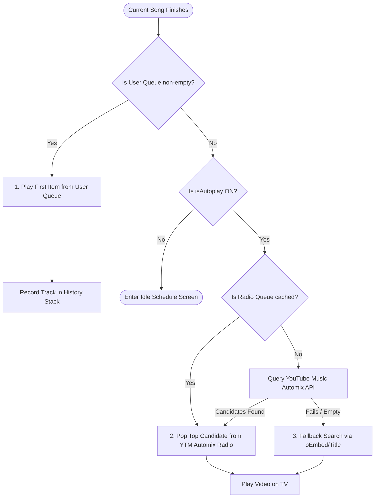

# Playback, Queue & Smart Autoplay Engine

At its heart, MediaBox is an intelligent jukebox. But unlike ordinary media players that fall silent or play inappropriate videos when a playlist ends, MediaBox features an industrial-grade **YouTube IFrame playback pipeline** paired with an **Automix Recommendation Engine** that preserves party momentum.

This document explains how media playback works under the hood, how player errors are gracefully resolved, and the algorithms behind the tri-tier queue and smart autoplay.

---

## YouTube IFrame Integration & Resilience (`YouTubePlayer.tsx`)

Playing video on the web—especially across Smart TVs, desktop browsers, and mobile devices—is notorious for edge cases. MediaBox manages the YouTube IFrame player with extreme care.

### 1. Dynamic Script Injection & Player Re-use
When the TV Dashboard mounts, `YouTubePlayer.tsx` checks `window.YT`. If not present, it dynamically injects `https://www.youtube.com/iframe_api`.
- **Instance Reuse**: When switching tracks, MediaBox **never destroys the IFrame DOM element**. Destroying and recreating an iframe forces a complete browser layout recalculation and re-initializes YouTube's internal audio pipeline. Instead, MediaBox calls `playerRef.current.loadVideoById(videoId)`, making track switches instantaneous (< 150ms).

### 2. Embedded Playback Restriction Auto-Recovery (Error 150 / 101)
Certain record labels or artists disable playback on third-party websites (returning error code `150` or `101`). Without defensive coding, the TV would get stuck on a black screen forever.

MediaBox intercepts player errors:
```typescript
const onError = (event: any) => {
  const code = event.data;
  // Code 101 or 150: playback disabled in embedded players
  if (code === 101 || code === 150) {
    setEmbedError(t('player.embedRestrictedError'));
    // Trigger auto-skip after 3.5 seconds
    autoSkipTimerRef.current = setTimeout(() => {
      onEndedRef.current?.();
    }, 3500);
  }
};
```
If an embed-restricted video is encountered, MediaBox displays a helpful on-screen countdown and automatically skips to the next playable song.

### 3. Browser Autoplay Policy & Interaction Barrier
Modern browsers (Chrome, Safari, webOS) prohibit unmuted video playback before the user has interacted with the page. If a room auto-launches, MediaBox detects unmuted autoplay rejection and displays a sleek, sci-fi **"Click to Start Playback"** prompt to satisfy the browser's audio context gesture requirement.

---

## The Tri-Tier Queue Hierarchy (`playbackHandler.ts`)

When a song finishes, MediaBox transitions to the next track using a strict 3-tier precedence hierarchy:



### Tier 1: The User Queue (Human Choice First)
- Explicit user requests stored in `rooms/<room>/queue` **always take absolute priority**.
- Even if the system is currently playing an automated radio mix, the moment a guest queues a track, that song plays next.

### Tier 2: YouTube Music Automix Radio (`radioQueue`)
- When user requests run out, MediaBox queries YouTube Music's native automix radio algorithm (seeded by the track that just finished).
- Songs are fetched in batches (typically 10-25 candidates) and cached in `radioQueue`.

### Tier 3: Built-In Search Fallback
- If the Cloudflare Worker proxy is unreachable or YouTube Music radio is unavailable, MediaBox falls back to search queries based on the current song and artist name.

---

## The Smart Autoplay Algorithm (`autoplayHandler.ts`)

Unfiltered YouTube autoplay is disastrous for communal listening. Left unattended, YouTube will happily queue:
- A 10-hour looped meme track.
- A 45-minute video essay or podcast.
- A VEVO music video featuring a 2-minute dialogue skit before the music starts.
- The exact same artist 6 times in a row.

MediaBox implements a multi-stage filtering and ranking heuristic:

### 1. Audio Purity Scoring (`scoreAudioPurity`)
Every candidate video receives a purity score from **0 to 3**:

| Score | Criteria | Rationale |
| :---: | :--- | :--- |
| **3** | Auto-generated ` - Topic` channel | Official YouTube Music audio release. Pure master studio audio with zero skits or intro noise. |
| **2** | Title contains `"Official Audio"` or `"Lyric Video"`, or official record label channel | High-fidelity music release with minimal extraneous video content. |
| **1** | Standard video match | Accepted if higher-scoring candidates are unavailable. |
| **0** | VEVO music video, duration > 12 minutes (`720s`), or contains `"MV"` / `"Music Video"` | Discarded when pure audio is preferred. Eliminates cinematic intro scenes. |

### 2. Anti-Compilation & Anti-Loop Detection (`isUnwantedLongOrCompilation`)
Candidate titles are inspected against regex patterns:
- **Loops**: `/\b\d+\s*(hours?|hrs?|h)\b/`, `/\b(infinite\s*loop|continuous\s*loop)\b/`.
- **Compilations & Mixes**: `/\b(full\s*album|complete\s*album|discography|greatest\s*hits|megamix|dj\s*mix|24\/7)\b/`.
Matches are instantly discarded.

### 3. String Normalization & Duplicate Prevention (`isDuplicateSong`)
Tracks are stripped of noise words:
```typescript
const NOISE_TAGS_RE = /[\(\[\{][^\)\]\}]*(official|music\s+video|video|audio|lyric|super\s+slowed|slowed|reverb|sped|remix|edit|cover|mv|hd|4k)[^\)\]\}]*[\)\]\}]/gi;
```
If a candidate's normalized track name matches the currently playing track or any title in the last **20 played tracks**, it is rejected to avoid repetitive loops.

### 4. Artist Repeat Prevention (`isArtistRepeatLimitReached`)
To mirror professional radio broadcasting standards, MediaBox extracts the artist's name using `parseTrackAndArtist()` and compares it against recent playback history:
```typescript
export const isArtistRepeatLimitReached = (
  candidateArtist: string,
  recentArtistHistory: string[]
): boolean => {
  if (!candidateArtist || recentArtistHistory.length === 0) return false;
  // Disallows playing the same artist twice in a row
  return isSameArtist(candidateArtist, recentArtistHistory[0]);
};
```

---

## Previous Track History Stack (`useAutoplayHistory.ts`)

MediaBox maintains an in-memory chronological history stack of played tracks:
```typescript
export interface PlayedTrack {
  url: string;
  title: string;
  channelTitle?: string;
  playedAt?: number;
}
```
When an admin or host taps **"Previous Track"** (or presses the rewind button on a physical TV remote):
1. `transitionToPreviousPlayback()` pops the last track off the history stack.
2. The current song is replaced with the previous track in `state/currentlyPlaying`.
3. The queue remains completely intact.

---

## Debounced Volume Control (`useDebouncedVolume.ts`)

Dragging a volume slider fires continuous `onChange` events at 60Hz. Writing each change to Firebase RTDB would generate hundreds of network packets, trigger rate-limit throttling, and overwhelm the TV.

MediaBox handles this with a dedicated hook:
- **Immediate Local State**: The slider thumb moves instantly with zero visual lag.
- **Debounced Network Flush**: The database update is held back for `200ms` until the user finishes moving the slider, sending a single clean update to `state/playback/volume`.
