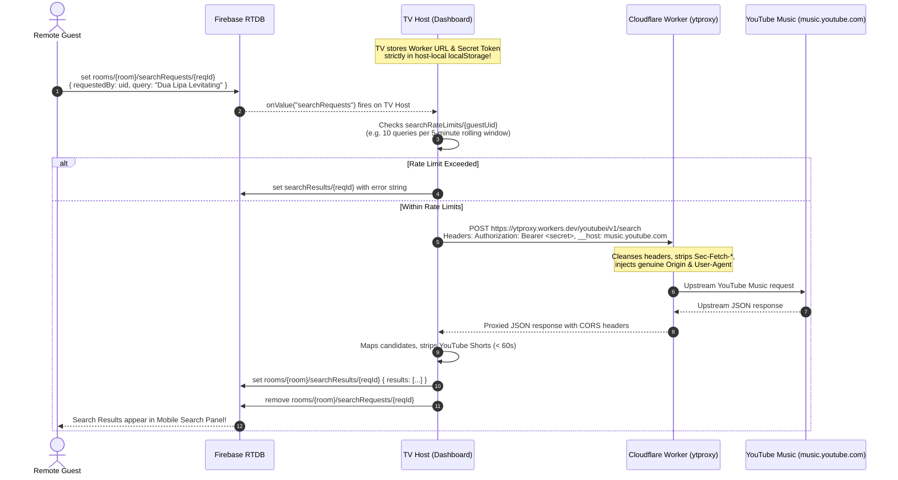

# Search Proxy & Cloudflare Worker

Searching for songs and tracks on YouTube without paying for enterprise APIs or leaking sensitive developer keys to every guest's phone is one of MediaBox's neatest technical achievements.

This document details the **Privacy-Preserving Search Mediation Architecture**, the **Innertube (`youtubei.js`) integration**, and the **Cloudflare Worker CORS Proxy (`ytproxy`)** that bypasses Google BotGuard restrictions.

---

## The Privacy-Preserving Proxy Problem

When designing a watch party system where arbitrary guests join via their personal phones:

1. **You cannot give API keys to guest phones**: If you hardcode a YouTube Data API v3 key into the client web app or store it in Firebase RTDB, anyone with DevTools can steal your quota or trigger billing spikes.
2. **Browsers block direct YouTube Music API calls**: Modern browsers enforce CORS. Furthermore, Google's `WEB_REMIX` (YouTube Music) internal endpoints check browser security headers (`Sec-Fetch-Site: cross-site`), triggering automated **403 Forbidden BotGuard blocks**.
3. **Guests should not need setup**: Guests should just open the link, type "Blinding Lights", and see instant results.

---

## The Mediated Search Architecture

MediaBox solves this by using the **TV Host as a Secure Mediation Gateway**:



### Why this is rock-solid:
- **Zero Secret Exposure**: The proxy URL and secret Bearer token live in the TV Host's `localStorage` (`mediabox_ytproxy_config`). They are **never written to Firebase RTDB** and never visible to remote phones.
- **Per-User Rate Limiting**: The TV Host enforces rolling-window rate limits (configurable in TV Settings, e.g. 10 searches per 5 minutes per user), preventing anyone from spamming searches.
- **Direct Link Passthrough**: If a guest pastes a full YouTube URL (`https://youtu.be/...`), it bypasses the search proxy entirely and queues immediately using YouTube's free oEmbed endpoint!

---

## Cloudflare Worker Deep Dive (`workers/ytproxy/`)

The Cloudflare Worker proxy (`workers/ytproxy/src/index.ts`) is designed to run on Cloudflare's global edge network.

### 1. BotGuard Evasion & Header Cleansing
This is the single most critical trick in the proxy. When a browser initiates a cross-origin `fetch()` to an external endpoint, it automatically attaches:
- `Sec-Fetch-Site: cross-site`
- `Sec-Fetch-Mode: cors`
- `Origin: https://your-mediabox-domain.com`

If forwarded to Google, Google's BotGuard immediately identifies the request as an unauthorized third-party scraper and returns **403 Forbidden**.

**The Cloudflare Worker sanitizes the request completely**:
```typescript
// workers/ytproxy/src/index.ts
const allowedClientHeaders = [
  'content-type',
  'accept',
  'accept-language',
  'x-youtube-client-name',
  'x-youtube-client-version',
  'x-goog-visitor-id',
  'x-origin',
];

// Strip browser-fingerprinting and cross-site headers:
for (const [key, value] of request.headers.entries()) {
  if (allowedClientHeaders.includes(key.toLowerCase())) {
    forwardHeaders.set(key, value);
  }
}

// Spoof authentic first-party origin:
forwardHeaders.set('Origin', `https://${targetHost}`);
forwardHeaders.set('Referer', `https://${targetHost}/`);
forwardHeaders.set('User-Agent', 'Mozilla/5.0 (Windows NT 10.0; Win64; x64) AppleWebKit/537.36 ...');
```

### 2. Target Host Routing
By default, the proxy directs traffic to `music.youtube.com`. If Innertube requires standard YouTube endpoints, it sets `__host: www.youtube.com` via query parameter or header. The worker strips the `__host` parameter before forwarding the query.

### 3. Bearer Token Authentication
To prevent random internet users from abusing your Cloudflare Worker quota, you can configure an optional secret in Cloudflare:
```bash
npx wrangler secret put YTPROXY_SECRET
```
The worker verifies `Authorization: Bearer <token>` on every request.

---

## The YouTube Music Innertube Module (`src/lib/ytmusicSearch.ts`)

On the client side, MediaBox uses `youtubei.js` (Innertube) configured with a custom `fetch` handler:

1. **Fast Session Generation**:
   ```typescript
   const yt = await Innertube.create({
     fetch: customFetchHandler,
     generate_session_locally: true,
     enable_safety_mode: false,
   });
   ```
   Setting `generate_session_locally: true` creates local visitor data without making extraneous round-trips to YouTube servers.
2. **Shorts & Podcast Filtering**:
   - YouTube Music occasionally returns YouTube Shorts or podcast episodes.
   - Any candidate with `duration.seconds < 60` is automatically discarded.
   - Only items with `item_type` in `['song', 'video']` are kept.

---

## Cloudflare Worker Setup & Deployment Guide

Follow these steps to deploy your own search proxy in under 3 minutes:

### Step 1: Navigate to the Worker Directory
```bash
cd workers/ytproxy
```

### Step 2: Deploy to Cloudflare
```bash
npx wrangler deploy
```
Wrangler will output your unique live URL, for example:
`https://mediabox-ytproxy.<your-subdomain>.workers.dev`

### Step 3: (Optional but Recommended) Set Auth Token
```bash
npx wrangler secret put YTPROXY_SECRET
# Enter a secret passphrase (e.g. "MySuperSecretKey123")
```

### Step 4: Configure in MediaBox
1. Open the MediaBox TV Dashboard (`/`).
2. Click the **Settings Gear** in the top-left corner -> Go to the **API Keys / Proxy** tab.
3. Under **YouTube Music CORS Proxy**:
   - Paste your **Worker URL** (`https://mediabox-ytproxy.<subdomain>.workers.dev`).
   - Enter your **Proxy Auth Token** (if set).
4. Click **Save Proxy Settings**. The badge will switch to **`PROXY CONFIGURED`**.
